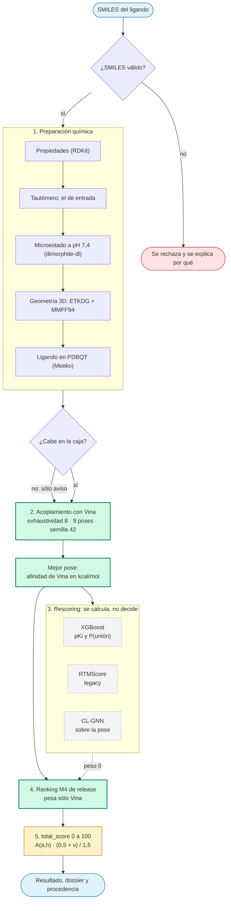
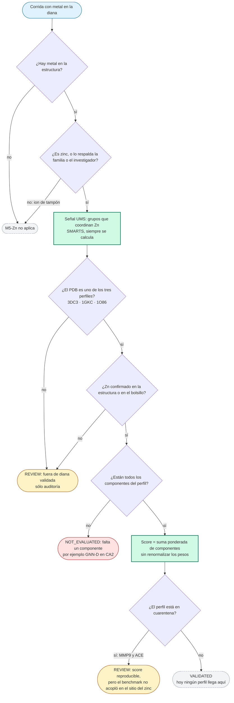
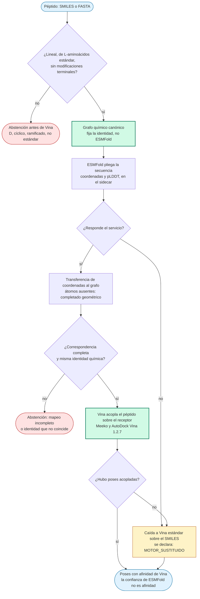
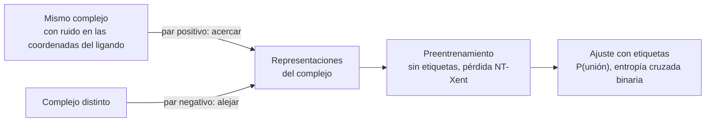
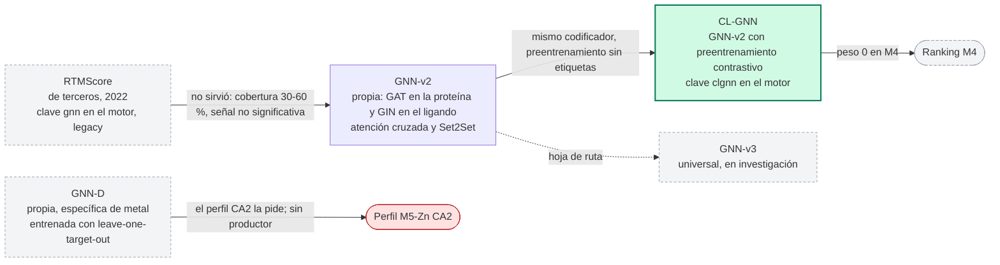

# Diagramas de los protocolos de MolDesign

Estado del código: octubre de 2026 (versión 1.0.4). Cada diagrama resume lo que hace el código en `backend/`. Los números son los que registran los documentos del repositorio.

Los diagramas están en sintaxis Mermaid. Se pueden pegar en GitHub, Notion, Obsidian o en el editor Mermaid, o convertir a SVG o PNG con `mermaid-cli`.

---

## Cómo leer los diagramas

| Forma o color | Significado |
|---|---|
| Caja redondeada | Entrada o resultado |
| Rectángulo | Paso de cálculo |
| Rombo | Decisión (sí o no) |
| Verde | Paso que decide el resultado |
| Gris punteado | Se calcula, pero no decide (peso 0) |
| Rojo | Abstención: no se calcula, o se rechaza |
| Amarillo | Revisión: resultado que necesita mirada humana |

### Glosario mínimo

| Término | Qué es |
|---|---|
| **Vina** | AutoDock Vina 1.2.7. Acopla un ligando en un receptor y devuelve una afinidad en kcal/mol. Es el único motor de acoplamiento. |
| **Afinidad de Vina** | Energía estimada de la mejor pose. No es una energía libre ni un Ki. |
| **PDBQT** | Formato de entrada de Vina. Lleva coordenadas, cargas e hidrógenos. |
| **Meeko** | Herramienta que prepara receptor y ligando en formato PDBQT. |
| **Tautómero** | Forma isomérica de una molécula que cambia la posición de un hidrógeno. |
| **Microestado** | Forma protonada concreta del ligando a un pH dado. |
| **SMARTS** | Patrón químico escrito en texto. Aquí detecta grupos que coordinan zinc. |
| **Spearman ρ** | Correlación de rangos entre el score y la afinidad medida. Va de −1 a 1. |
| **LOTO** | Leave-one-target-out: el modelo se evalúa con una diana entera fuera del entrenamiento. |

---

## 1. Protocolo M4: ranking general

**La idea en una frase.** M4 es el camino por defecto. Convierte un SMILES en un ligando 3D, lo acopla con Vina y devuelve la afinidad de Vina. El índice 0–100 es una transformación de esa afinidad.

### Qué pasa en cada paso

| Paso | Qué hace | Por qué importa |
|---|---|---|
| 1. Preparación | Fija el tautómero, el microestado a pH 7,4 y la geometría 3D | Define qué átomos donan y cuáles aceptan. Hoy el pH es uno solo y no se calcula un pKa. |
| Caja | Comprueba si el ligando cabe en la caja de docking | Sólo avisa. No bloquea. |
| 2. Vina | Genera 9 poses y toma la mejor | Es la única fuente de la afinidad y del ranking. |
| 3. Rescoring | Calcula XGBoost, RTMScore y CL-GNN | Se guardan para estudio. Ninguno cambia el ranking. |
| 4. Ranking | Usa sólo Vina | Así se decidió en la fase 6 ([docs/90_FASE6_DECISION_M4.md](../90_FASE6_DECISION_M4.md)). |
| 5. total_score | Transforma la afinidad en un índice de 0 a 100 | Vina entra dos veces, como afinidad y como factor de stacking. No ordena mejor que Vina (ver SUP-02). |

### Lo que M4 no hace

- No calcula energía libre (FEP) ni dinámica molecular.
- No tiene en cuenta el zinc ni otros metales. Para eso está M5-Zn.
- No modela flexibilidad del receptor: Vina acopla contra un receptor rígido.

---

## 2. Protocolo M5-Zn: metaloenzimas de zinc

**La idea en una frase.** Si la diana tiene zinc catalítico, M5-Zn añade una señal que detecta grupos capaces de coordinar el zinc y combina varias señales con pesos fijos. Sólo existe para tres dianas. Hoy su resultado sirve sobre todo para auditar: ningún perfil queda validado.

### Los tres perfiles

| Diana (PDB) | Fórmula | Estado hoy |
|---|---|---|
| CA2 (3DC3) | 0,20·Vina_norm + 0,20·XGB + 0,20·GNN-D + 0,40·UMS | Falta GNN-D, que no tiene productor en producción. Devuelve NOT_EVALUATED. |
| MMP9 (1GKC) | 0,75·XGB + 0,25·UMS | En cuarentena. El sitio del benchmark está a 18,7 Å del zinc. |
| ACE (1O86) | 0,20·Vina_norm + 0,40·XGB + 0,40·UMS | En cuarentena. El centroide de las poses está a 13 Å del zinc. |

- **Vina_norm** = |afinidad de Vina| dividida por una referencia fija del perfil (10,450 en CA2 y 9,566 en ACE), acotada a 1. En MMP9 no entra Vina.
- **UMS** = 0 si no hay grupo ligador de zinc. Si lo hay, vale 0,85 + 0,10·min(n/3, 1), donde n es el número de grupos distintos.
- **GNN-D** es un modelo de grafos específico de metal, entrenado con leave-one-target-out.

### Estados posibles

| Estado | Qué significa |
|---|---|
| VALIDATED | Perfil exacto con todos los componentes. Ningún perfil lo produce hoy. |
| NOT_EVALUATED_MISSING_COMPONENT | Falta un componente con peso distinto de cero. No se renormalizan los pesos. |
| REVIEW_INVALID_BENCHMARK_SITE | El score se calcula y se reproduce, pero el benchmark que validó el perfil no acopló en el sitio del zinc. |
| REVIEW_OUT_OF_VALIDATED_TARGET | El PDB no tiene perfil, o el zinc no está confirmado en la estructura. |
| BLOCKED_PROTOCOL_NOT_AVAILABLE | Otro metal sin adaptador. |

El código define además estados de procedencia incompleta y de top-1 sin coordinación. Están en [backend/services/pipeline/protocols/m5/zinc.py](../../backend/services/pipeline/protocols/m5/zinc.py).

### Límites que conviene tener presentes

- Vina no tiene un término de coordinación con el metal. Conservar el ion en el receptor no mejora la pose (MET-01-R1, NO_GO).
- Un score de M5-Zn no es evidencia de acoplamiento metaloproteico. Así lo dice el propio mensaje del resultado cuando el perfil está en cuarentena.

---

## 3. Protocolo péptidos: ESMFold + Vina

**La idea en una frase.** El péptido se pliega con ESMFold. Sus coordenadas se transfieren a un grafo químico que fija la identidad de la molécula, y Vina lo acopla. Si algo no encaja, el protocolo se abstiene o cae a Vina estándar.

### Alcance y límites

- **Entra:** péptidos lineales de aminoácidos L estándar, con glicina aquiral y estereoquímica declarada.
- **Se abstiene:** D-aminoácidos, residuos no canónicos, péptidos cíclicos o ramificados, modificaciones terminales, estereoquímica ambigua o mapeo atómico incompleto.
- **Qué está validado:** que ESMFold carga y sirve estructuras. No está validado que las poses sean buenas.
- **Refinamiento con OpenMM:** desactivado. La ruta no está validada.
- **Procedencia:** la identidad química viene del SMILES o del FASTA. ESMFold aporta sólo geometría.

---

## 4. Anexo: por qué hay varias GNN

**La idea en una frase.** GNN significa «red neuronal de grafos». Es una familia de modelos, no un modelo. En el repositorio hay varios, de distinto origen y con distinto destino.

### Qué significa «CL»

**CL = Contrastive Learning** (aprendizaje contrastivo). Es una forma de entrenar sin etiquetas. El modelo aprende a reconocer lo que es el mismo complejo y lo que no lo es.

El preentrenamiento no necesita saber si el ligando se une. Sólo necesita que dos vistas del mismo complejo se parezcan y que dos complejos distintos no. Después, un ajuste corto con etiquetas enseña la tarea real.

### Linaje de los modelos

### Tabla de modelos

| Modelo | Origen | Qué hace | Estado hoy |
|---|---|---|---|
| **RTMScore** (clave `gnn`) | Terceros, Shen et al., JCIM 2022. Código con licencia MIT, vendorizado en `rescoring/RTMScore/`. | Transformer de grafos sobre el complejo proteína-ligando. Entrenado con poses cristalográficas de PDBbind. | Legacy. Su peso en el ranking es 0 y el motor lo marca como obsoleto. |
| **GNN-v2** | Propio. | Codificador GAT para la proteína, GIN para el ligando, atención cruzada y Set2Set. Predice P(unión). | Es la base de CL-GNN. Sin preentrenamiento sirvió de comparación: en ACE, sin entrenar en esa diana, su AUC fue 0,283. |
| **CL-GNN** (clave `clgnn`) | Propio. GNN-v2 con preentrenamiento contrastivo y luego ajuste con etiquetas. | Se calcula sobre la pose acoplada de Vina. | Peso 0 en M4. En CA2, AUC 0,592. En ACE, zero-shot, 0,405. El checkpoint no tiene validación externa sellada. |
| **GNN-D** | Propio, específico de metal. | Modelo de grafos entrenado con leave-one-target-out. | En CA2, AUC 0,646 con LOTO. Sin productor en producción. Los entrenamientos anteriores se invalidaron por fuga de datos. |
| **GNN-v3** | Propio. | Propuesta universal: añadir tipo de nodo para proteína, ADN, ARN y glicanos. | En investigación. No lo he rastreado hasta un peso del ranking actual. |

### Por qué hay dos GNN activas en el código

1. **RTMScore era la primera opción y falló.** Se entrenó con poses cristalográficas y se aplicó a poses acopladas, un cambio de dominio. Además, no construía el grafo para una parte de las moléculas, y su correlación no fue significativa.
2. **Se hizo un modelo propio.** GNN-v2 se diseñó para aprender una señal distinta de Vina y de XGBoost.
3. **Con pocas etiquetas, se preentrenó sin ellas.** CL-GNN aprende primero a reconocer el mismo complejo bajo ruido en el ligando. Después se ajusta con etiquetas de unión.
4. **El nombre «gnn» en el motor sigue apuntando a RTMScore**, aunque el modelo propio se llama CL-GNN. Por eso en el motor hay dos claves distintas.

Hoy ninguno de los dos modelos decide el ranking de M4. Sólo Vina pesa. CL-GNN y RTMScore se conservan para comparar en el futuro, cuando haya validación externa.

---

## Referencias del repositorio

- Protocolo M4 y ranking: `docs/90_FASE6_DECISION_M4.md`
- Arquitectura de protocolos: `docs/74_ARQUITECTURA_DISPATCHER_DE_PROTOCOLOS.md`
- Decisión de M5-Zn: `docs/75_DECISION_CIENTIFICA_M5_ZN_V1.md`
- Transferencia de ESMFold a un ligando: `docs/76_DECISION_TRANSFERENCIA_ESMFOLD_A_LIGANDO_V1.md`
- Arquitectura GNN-v2 (documento histórico): `docs/gnn_v2_arquitectura.md`
